<div align="center">

# Showzy

### See the view before you book.

Browse movies, matches and concerts. Walk into the exact hall or stadium in **3D**, fly onto a seat, and look at the screen from where you will sit.
Then check out through a clearly labelled **simulated** gateway, while an **AI-assisted anti-scalping engine** watches the inventory.

<br/>


<br/>

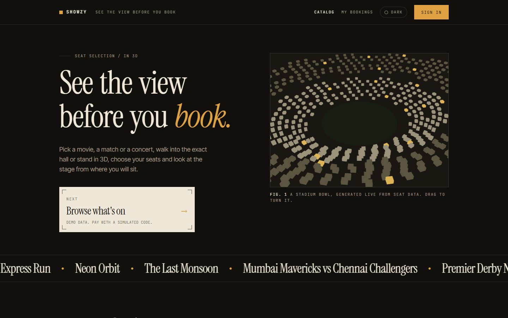

<sub><b>Demo project.</b> No real tickets, no real payments. Venues and listings are fictional.</sub>

<br/>

[**Features**](#-features) · [**Screenshots**](#-screenshots) · [**Architecture**](#-architecture) · [**Run it locally**](#-run-it-locally) · [**Tests**](#-tests) · [**Design notes**](#-design-notes)

</div>

---

## ✦ Features

<table>
<tr>
<td width="50%" valign="top">

### 🎬 Venue-true 3D seat selection
- Every show opens **its own** hall or stadium: two cinema screens of different sizes, a cricket stadium and a concert arena, generated from real seat data.
- **Click a seat and the camera flies onto it.** A card shows the distance to the screen, how much of your view it fills, and how far off-centre you are.
- **View from this seat** dives into your eye position. Drag to look around and switch between your seats.
- A fully accessible **2D map** picks the very same seats.

</td>
<td width="50%" valign="top">

### 🎟️ Booking that can't double-sell
- **Atomic seat holds** in Postgres. Rows are locked in order and a hold is all-or-nothing, so 20 simultaneous buyers get exactly one winner.
- Holds expire after 5 minutes **without any background worker**.
- **The server owns every price.** Orders snapshot the amounts and the browser never sends one.
- A **simulated gateway** confirms with a one-time code, and only its HMAC is stored. Confirmation is idempotent and issues tickets exactly once.

</td>
</tr>
<tr>
<td width="50%" valign="top">

### 🛡️ Anti-scalping security engine
- Structured security events with allowlisted metadata and HMAC'd IPs.
- Rate limits stored in the database, so they survive restarts.
- **Explainable rules:** seat hoarding, hold velocity, payment probing, bulk holds, scraping.
- A policy engine applies a *temporary* hold limit. **Humans decide anything permanent**, with an append-only audit log.

</td>
<td width="50%" valign="top">

### 🤖 Gemini-assisted investigations
- A LangGraph pipeline runs **analyst → investigator → responder** on `gemini-3.5-flash-lite`, with at most 3 model calls.
- **Read-only and grounded:** hypotheses that cite evidence which doesn't exist are dropped.
- Personal data is redacted before prompting, and output is schema-validated.
- If the AI is unavailable, rules and policy keep working and a deterministic summary is shown.

</td>
</tr>
</table>

---

## ◐ Screenshots

### 3D venues

<table>
<tr>
<td width="50%">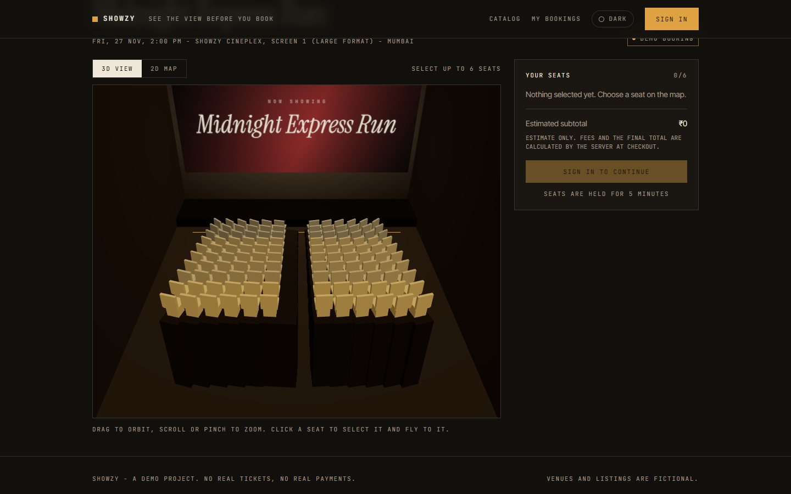<br/><sub><b>Cinema hall</b>: procedural room, the film's title card on screen, raked rows.</sub></td>
<td width="50%">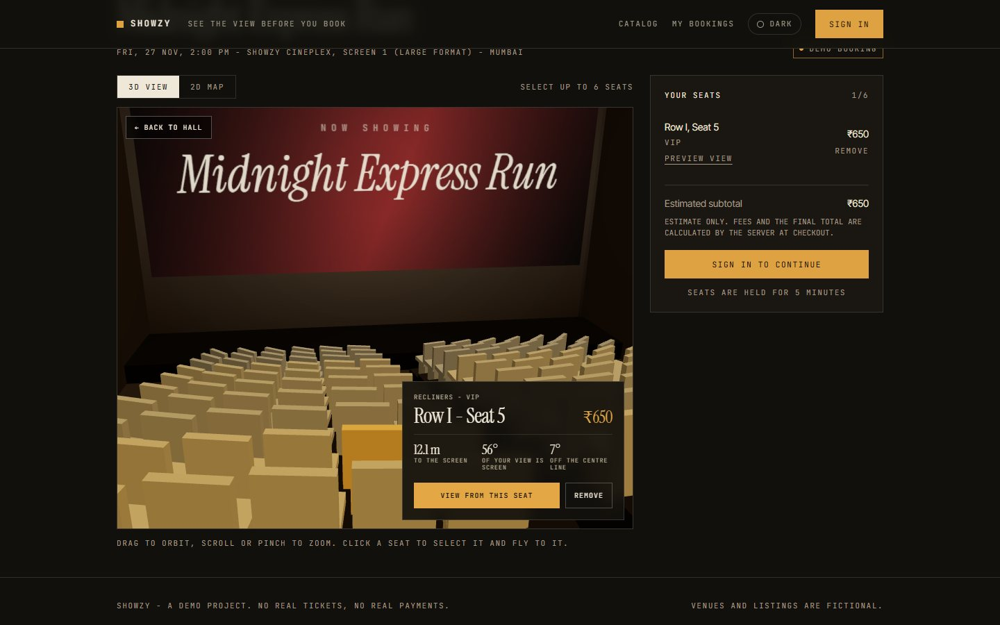<br/><sub><b>Fly-to-seat</b>: selecting a seat zooms onto it with live sightline stats.</sub></td>
</tr>
<tr>
<td width="50%">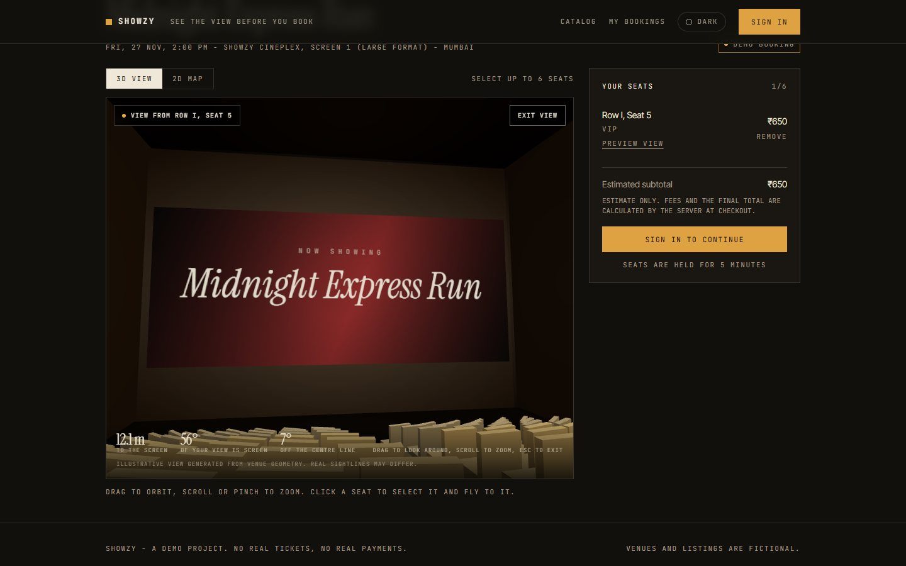<br/><sub><b>View from this seat</b>: drag to look around, scroll to zoom, switch seats.</sub></td>
<td width="50%">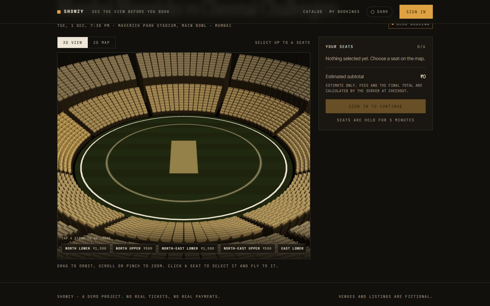<br/><sub><b>Stadium</b>: eight stands across two tiers, tap a stand to fly there.</sub></td>
</tr>
<tr>
<td width="50%">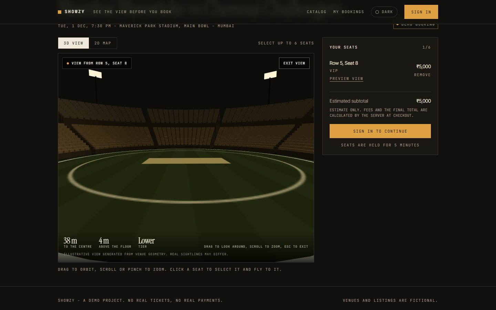<br/><sub><b>Stadium seat view</b>: floodlights, boundary rope, pitch.</sub></td>
<td width="50%">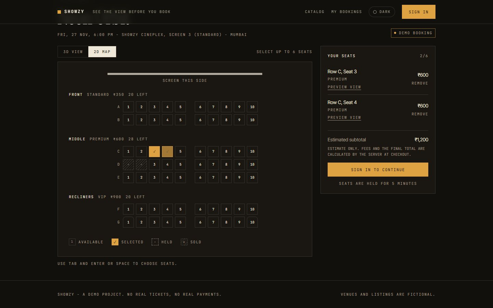<br/><sub><b>2D map</b>: keyboard and screen-reader friendly, same seat IDs as 3D.</sub></td>
</tr>
</table>

### Browse, book, pay

<table>
<tr>
<td width="50%">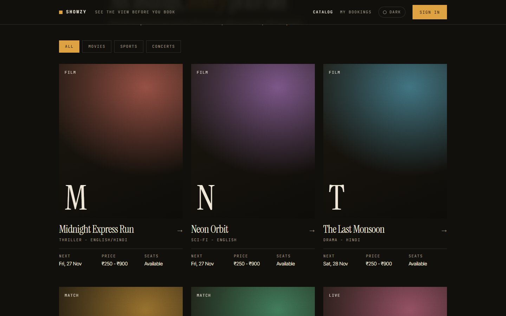<br/><sub><b>Catalog</b>: price ranges on every card, by category.</sub></td>
<td width="50%">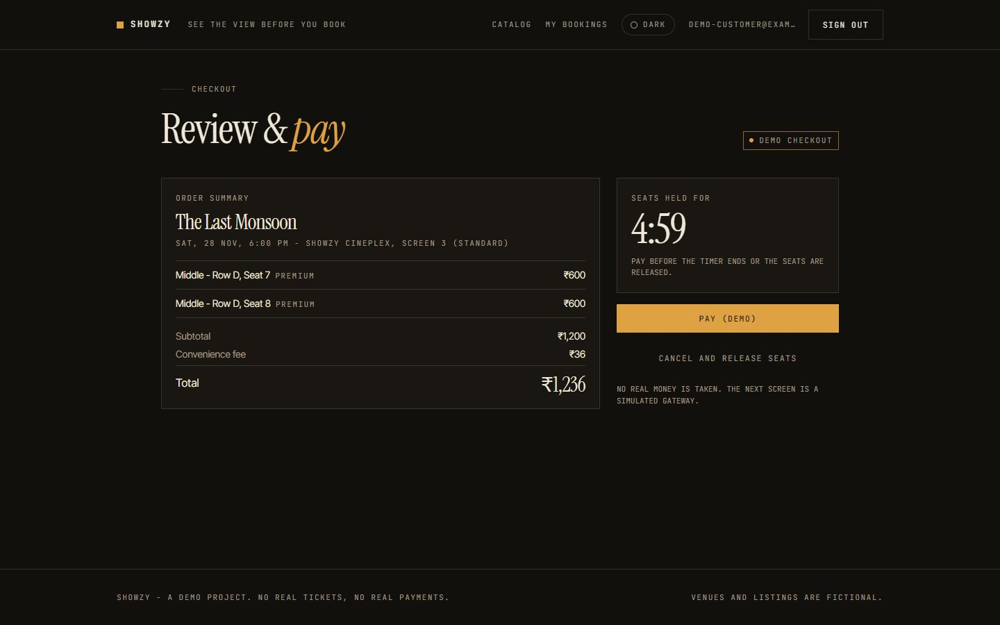<br/><sub><b>Checkout</b>: server-calculated total and a server-clock hold timer.</sub></td>
</tr>
<tr>
<td width="50%">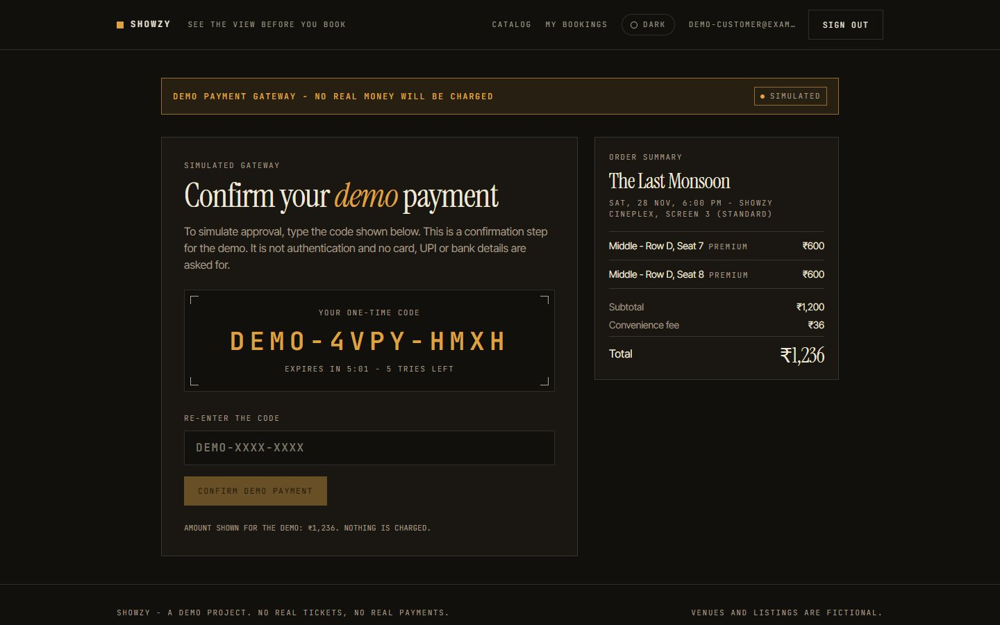<br/><sub><b>Demo gateway</b>: a one-time code, labelled as simulated everywhere.</sub></td>
<td width="50%">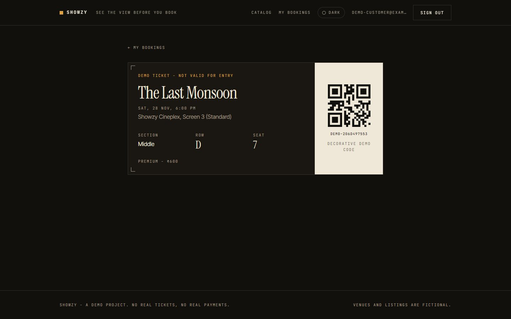<br/><sub><b>Demo ticket</b>: decorative code, "not valid for entry".</sub></td>
</tr>
</table>

### Security & AI

<table>
<tr>
<td width="50%">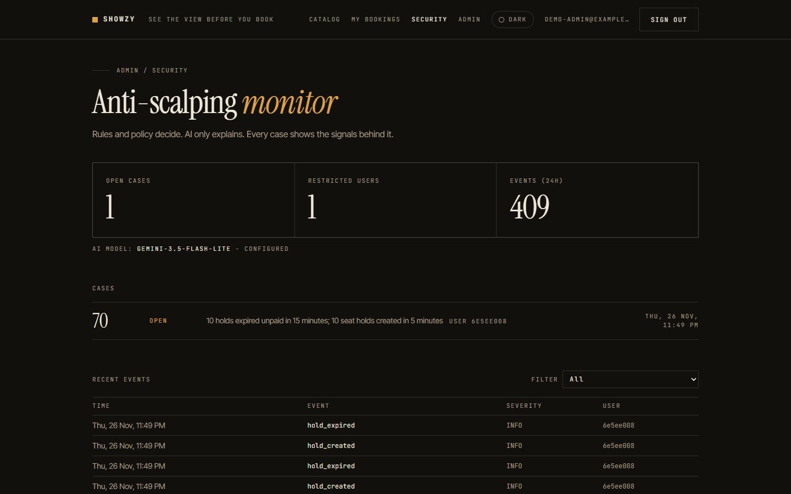<br/><sub><b>Security dashboard</b>: open cases, restricted users, live events.</sub></td>
<td width="50%">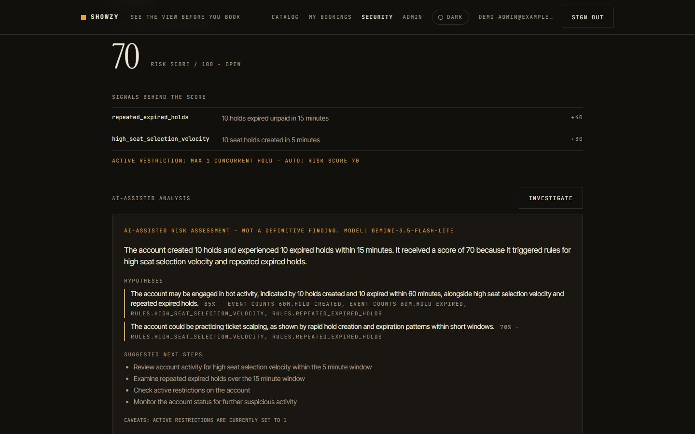<br/><sub><b>AI investigation</b>: grounded hypotheses with confidence and cited evidence.</sub></td>
</tr>
</table>

<details>
<summary><b>Light theme</b></summary>
<br/>
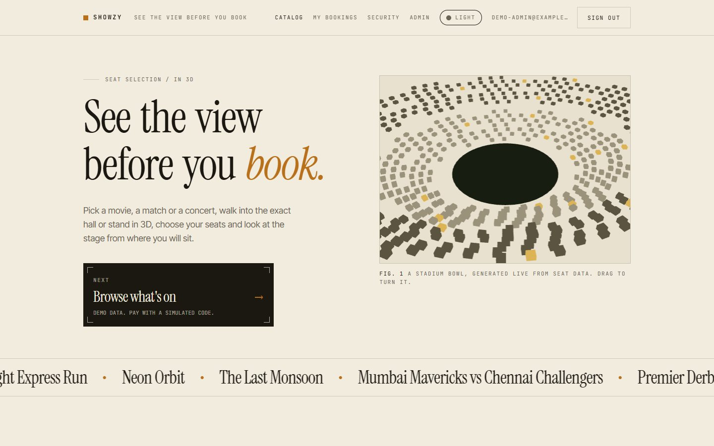
</details>

---

## ⌁ Architecture

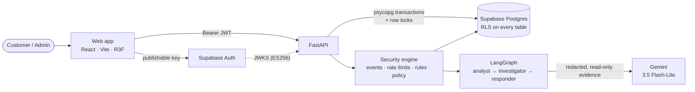

### Booking and demo payment flow

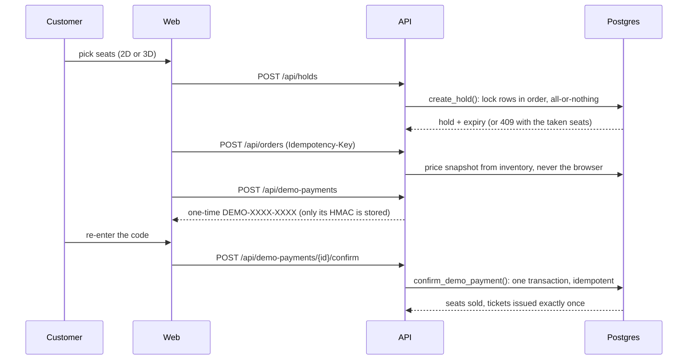

| Layer | Tech |
|---|---|
| **Web** | React 19 · Vite · TypeScript · Tailwind v4 · Motion · Lenis · React Three Fiber · TanStack Query |
| **API** | Python 3.12 · FastAPI · psycopg 3 · PyJWT (JWKS) |
| **Data and auth** | Supabase Postgres + Auth, Row Level Security, plain-SQL migrations with tested `down` files |
| **AI** | Gemini `gemini-3.5-flash-lite` (locked in config) · LangGraph · Pydantic-validated output |
| **Testing** | pytest (unit + live integration) · Vitest · Playwright (E2E, axe accessibility) |

---

## ▶ Run it locally

**Prerequisites:** Node 20+, Python 3.12, and a Supabase project (plus a Gemini key if you want the AI).

```powershell
# 1. Env: copy .env.example to .env at the repo root and fill it in

# 2. API
cd api
python -m venv .venv
.\.venv\Scripts\python -m pip install -r requirements-dev.txt
.\.venv\Scripts\python scripts\migrate.py up          # schema + RLS
.\.venv\Scripts\python scripts\seed.py                # venues, shows, seats, prices
.\.venv\Scripts\python scripts\create_demo_users.py   # demo accounts; passwords are written to .env

# 3. Web
cd ..\web
npm install

# 4. Start both (opens two windows)
cd ..
.\scripts\dev.ps1
```

Open **http://localhost:5173**. The API docs are at **http://localhost:8000/docs**.

<details>
<summary><b>Demo walkthrough</b></summary>

1. Open **Midnight Express Run**, pick a showtime, then click a seat in 3D and press **View from this seat**.
2. Sign in as `demo-customer@example.com`, continue to checkout, and pay with the code shown on screen.
3. Your demo tickets are under **My bookings**.
4. Run `python scripts/simulate_scalper.py` in `api/`. Then sign in as `demo-admin@example.com`, open **Security**, open the case and press **Investigate**.
5. Reset everything with `python scripts/seed.py --reset`.

</details>

---

## ✓ Tests

| Suite | Command | What it proves |
|---|---|---|
| **API**: unit + integration (66) | `cd api; .\.venv\Scripts\python -m pytest -q` | JWT and `alg:none` rejection, RLS boundaries, concurrent holds with one winner, expiry, server pricing, idempotency, payment codes, replay and lockout, rate limits, scalper detection, review flow, append-only audit log |
| **Web unit** | `cd web; npm test` | env guard, money formatting |
| **E2E + accessibility** | `cd web; npx playwright test` | guest browsing, 2D/3D selection, fly-to-seat, the full paid journey with wrong and right codes, ticket isolation, admin access, axe (WCAG AA), 375px layout, reduced motion, plus a **3D GPU-context regression test** |
| **Secret scan** | `.\scripts\secret_scan.ps1` | your real secret values and key shapes never appear in tracked files or the built bundle |

The integration tests run against a Supabase dev project using throwaway `test-*@example.com` users, which are deleted afterwards.

---

## ✎ Design notes

<details open>
<summary><b>3D that costs about what a 2D page costs</b></summary>

| Technique | Effect |
|---|---|
| Render **on demand** (`frameloop="demand"`) | **0 frames** while the view is still (asserted in E2E) |
| Time-based camera tweens | the same motion at any frame rate, with no jumps on slow phones |
| One `InstancedMesh` each for seats, steps and the crowd | about **7 draw calls** for a whole 2,240-seat stadium |
| Procedural geometry, tiny canvas textures | no model downloads |
| three.js lazy-loaded | none of it loads until the 3D view opens |
| Device tiers + runtime resolution fallback | lower resolution and no antialiasing on weak devices; very low-end phones open on the 2D map |
| No hover hit-testing on touch | orbit drags stay smooth on cheap phones |
| WebGL probed **once**, probe context released | fixes a real bug where re-probing on every render exhausted GPU contexts and blacked out the viewer |

</details>

<details>
<summary><b>Correctness and security</b></summary>

- **The browser is untrusted.** Prices, user identity and hold duration all come from the server or the verified token.
- **Holds expire at query time** plus opportunistic cleanup, so a sleeping free-tier server stays correct.
- **The demo payment code is a confirmation step, not authentication.** It is shown on the same page, and the UI says so.
- **No single-signal accusations.** An IP-only signal can't open a case by itself (shared networks exist).
- **No automatic bans.** The policy only applies a temporary hold limit; dismiss, restrict and escalate are human decisions, written to the audit log.
- **Known gap:** login-failure detection is out of scope, because those failures happen inside Supabase Auth and our API never sees them.

</details>

<details>
<summary><b>Project structure</b></summary>

```
Showzy/
├─ api/                 FastAPI app
│  ├─ app/
│  │  ├─ ai/            Gemini client, redaction, LangGraph investigation
│  │  ├─ layouts/       procedural cinema + bowl seat generators
│  │  ├─ routers/       catalog, booking, payments, security, admin
│  │  ├─ security/      events, rate limits, rules, scoring, policy
│  │  └─ services/      holds, orders, payments, catalog
│  ├─ scripts/          migrate, seed, demo users, scalper simulation
│  └─ tests/            unit + integration
├─ web/                 React app
│  ├─ src/viewer/       3D: Director (camera), Seats (instancing), Venue, perf tiers
│  ├─ src/pages/        catalog, seats, checkout, gateway, tickets, admin
│  └─ e2e/              Playwright + axe
├─ supabase/migrations/ SQL up/down migrations
└─ docs/screenshots/
```

</details>

---

<div align="center">
<sub>A portfolio demo. Not affiliated with any venue, league or cinema chain.</sub>
</div>
